# Frontend Mentor - Typing Speed Test solution

This is a solution to the [Typing Speed Test challenge on Frontend Mentor](https://www.frontendmentor.io/challenges/typing-speed-test). Frontend Mentor challenges help you improve your coding skills by building realistic projects. 

## Table of contents

- [Overview](#overview)
  - [Screenshot](#screenshot)
- [My process](#my-process)
  - [Built with](#built-with)
  - [What I learned](#what-i-learned)
  - [Continued development](#continued-development)
  - [AI Collaboration](#ai-collaboration)

## Overview

### Screenshot

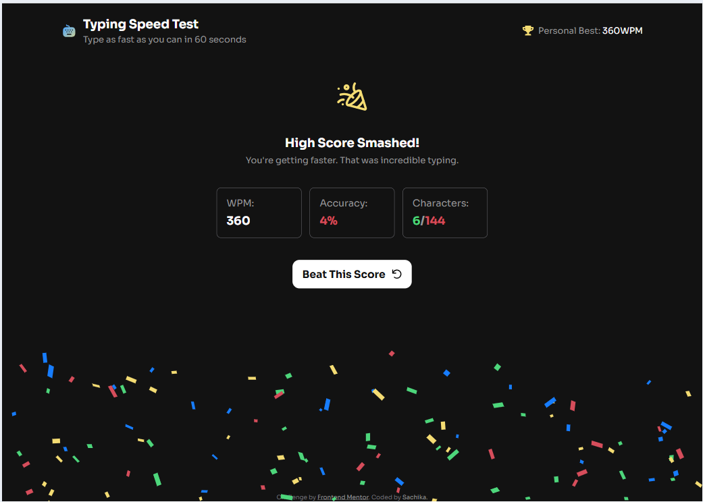
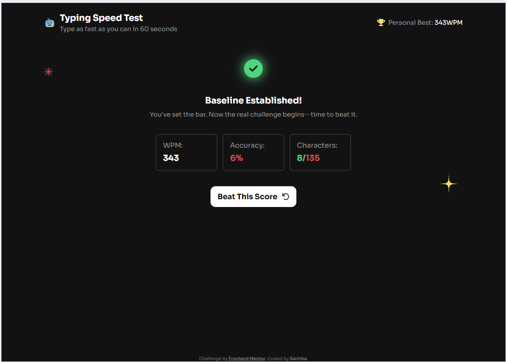
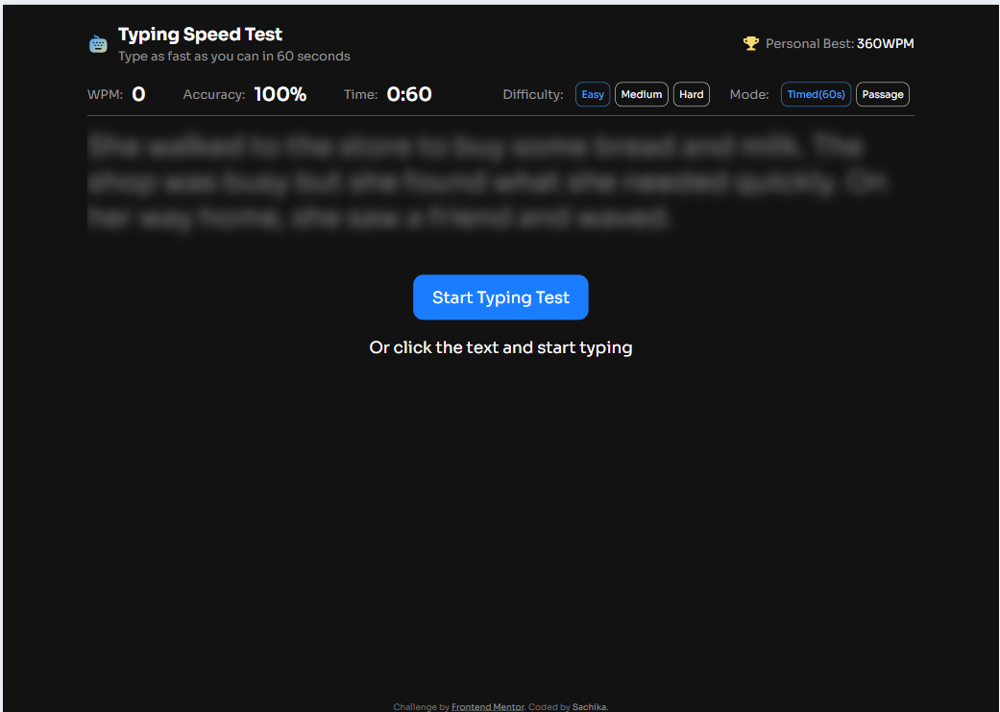
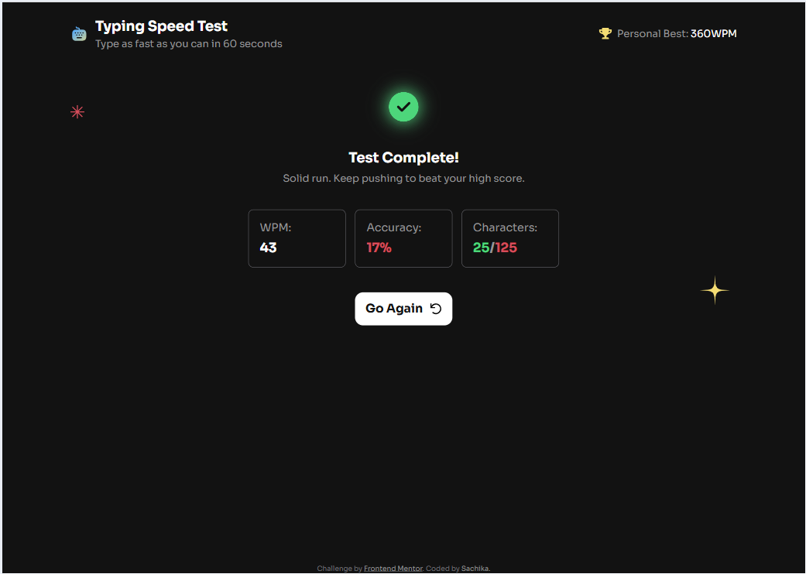
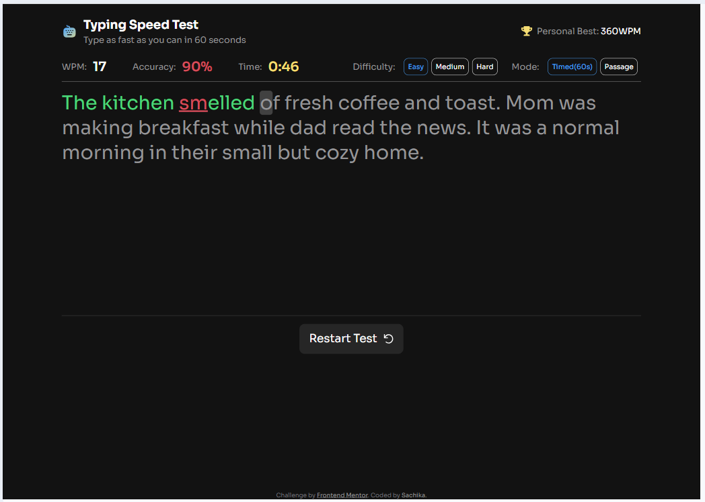
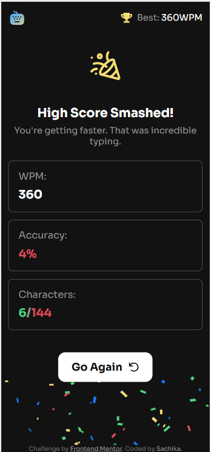
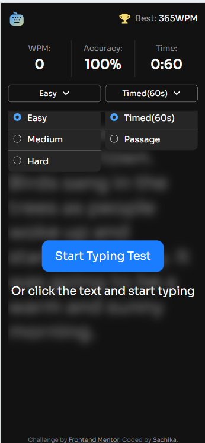
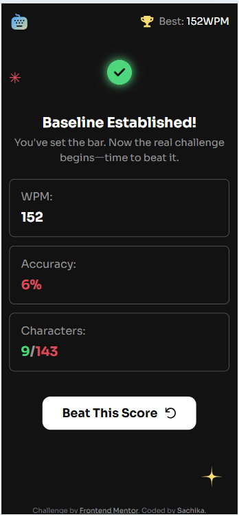
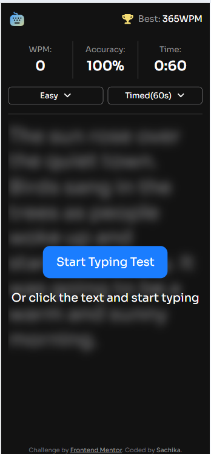
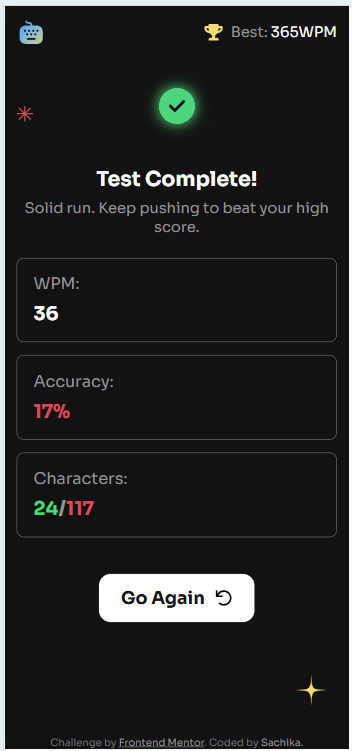
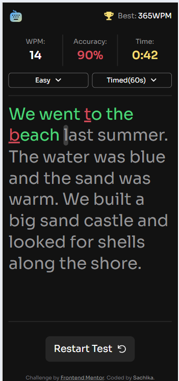

## My process

### Built with

- Semantic HTML5 markup
- CSS custom properties
- Flexbox
- CSS Grid
- Mobile-first workflow
- [React](https://reactjs.org/) - JS library

### What I learned

While working on this project, I learned how to use `useState` and `useEffect`, as well as how to lift state up to a common parent component. I also learned how to handle user interactions using event handlers such as `onClick` and `onChange` to update the state when users click buttons or change input values.

### Continued development

I want to keep practicing React and building more apps. However, I wasn't able to make this app work properly on smartphones, so I'd like to make my next app mobile-friendly.

### AI Collaboration

I used ChatGPT and GitHub Copilot to help me debug my code. Whenever an error occurred and my app stopped working, I asked AI to help me identify the cause and give me hints on how to fix it when I couldn't figure out what was wrong with my code.

